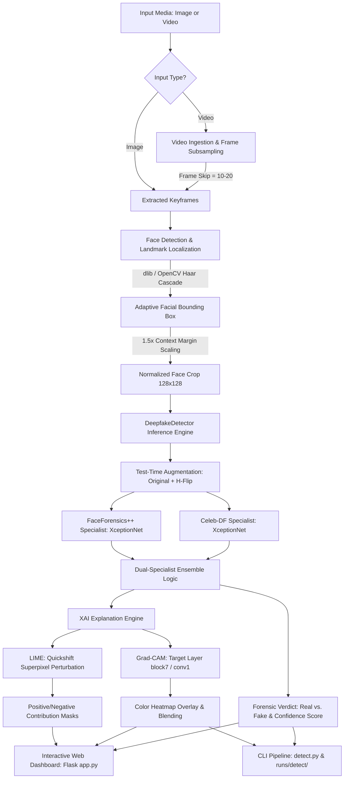
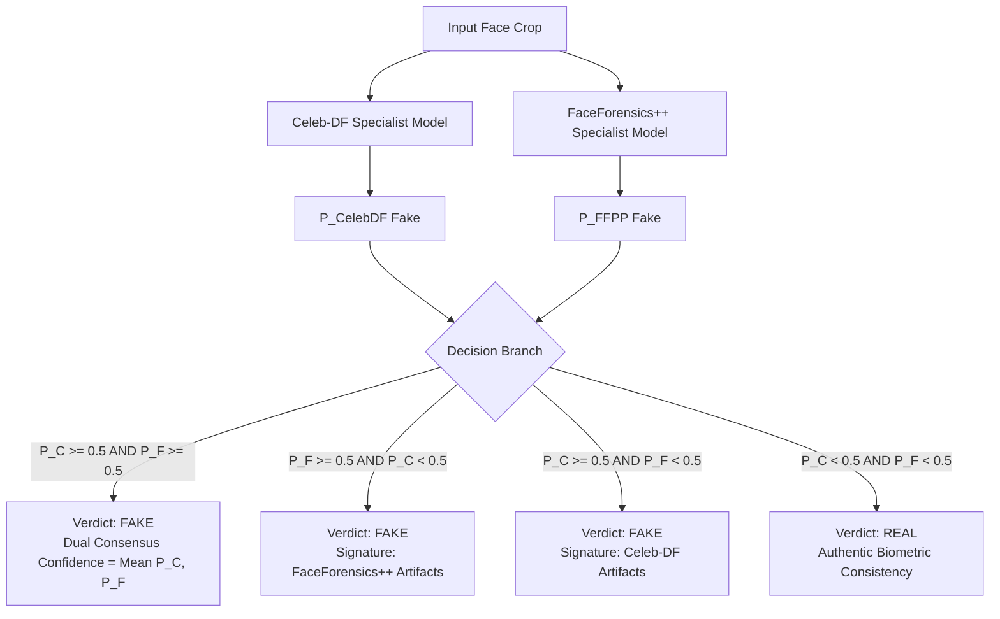

# Comprehensive Project Documentation: Explainable AI (XAI) for Deepfake Detection

---

## 📋 Table of Contents
1. [Executive Summary](#1-executive-summary)
2. [Real-World Problem & Motivation](#2-real-world-problem--motivation)
3. [System Architecture](#3-system-architecture)
4. [Datasets & Preprocessing Pipeline](#4-datasets--preprocessing-pipeline)
   - [FaceForensics++ (FF++)](#faceforensics-ff)
   - [Celeb-DF (v2)](#celeb-df-v2)
   - [Comparative Analysis of Datasets](#comparative-analysis-of-datasets)
   - [Face Extraction & Alignment Pipeline](#face-extraction--alignment-pipeline)
   - [Dataset Splits & Input Transformations](#dataset-splits--input-transformations)
5. [Machine Learning & Deep Learning Algorithms](#5-machine-learning--deep-learning-algorithms)
   - [Mathematical Formulation of the Detection Problem](#mathematical-formulation-of-the-detection-problem)
   - [Classical Machine Learning vs. Deep Learning (SVM, Logistic Regression, Random Forest)](#classical-machine-learning-vs-deep-learning-svm-logistic-regression-random-forest)
   - [How Regression is Internally Applied in the Architecture](#how-regression-is-internally-applied-in-the-architecture)
   - [XceptionNet (Extreme Inception) Deep Dive](#xceptionnet-extreme-inception-deep-dive)
   - [Depthwise Separable Convolutions vs. Standard Convolutions](#depthwise-separable-convolutions-vs-standard-convolutions)
   - [Transfer Learning & Fine-Tuning Strategy](#transfer-learning--fine-tuning-strategy)
   - [Loss Function: Binary Cross-Entropy with Logits](#loss-function-binary-cross-entropy-with-logits)
   - [Optimization: Adam (Adaptive Moment Estimation)](#optimization-adam-adaptive-moment-estimation)
   - [Training Hyperparameters & Environment](#training-hyperparameters--environment)
6. [Explainable AI (XAI) Framework](#6-explainable-ai-xai-framework)
   - [Why Explainability is Critical in Deepfake Forensics](#why-explainability-is-critical-in-deepfake-forensics)
   - [Algorithm 1: Grad-CAM (Gradient-Weighted Class Activation Mapping)](#algorithm-1-grad-cam-gradient-weighted-class-activation-mapping)
   - [Algorithm 2: LIME (Local Interpretable Model-Agnostic Explanations)](#algorithm-2-lime-local-interpretable-model-agnostic-explanations)
   - [Forensic Visual Interpretation of Model Decisions](#forensic-visual-interpretation-of-model-decisions)
7. [Inference Engine & System Implementation](#7-inference-engine--system-implementation)
   - [Adaptive Face Detection & Boundary Preservation](#adaptive-face-detection--boundary-preservation)
   - [Test-Time Augmentation (TTA)](#test-time-augmentation-tta)
   - [Specialist Ensemble Decision Logic](#specialist-ensemble-decision-logic)
   - [Temporal Video Processing Pipeline](#temporal-video-processing-pipeline)
   - [Interactive Flask Web Dashboard (`app.py`)](#interactive-flask-web-dashboard-apppy)
   - [Command-Line Interface (`detect.py`)](#command-line-interface-detectpy)
8. [Experimental Results & Evaluation Metrics](#8-experimental-results--evaluation-metrics)
   - [Quantitative Performance Metrics](#quantitative-performance-metrics)
   - [Confusion Matrix & Classification Report](#confusion-matrix--classification-report)
   - [Training & Validation Convergence Curves](#training--validation-convergence-curves)
9. [Applications, Challenges, Limitations & Ethics](#9-applications-challenges-limitations--ethics)
   - [Real-World Applications](#real-world-applications)
   - [Technical Challenges & Failure Modes](#technical-challenges--failure-modes)
   - [Ethical, Social & Legal Considerations](#ethical-social--legal-considerations)
10. [Repository Structure & File Map](#10-repository-structure--file-map)
11. [Step-by-Step Execution & Reproduction Guide](#11-step-by-step-execution--reproduction-guide)
12. [References](#12-references)

---

## 1. Executive Summary

This project delivers an end-to-end, high-accuracy, and **explainable deepfake detection system** that combines state-of-the-art computer vision architectures (**XceptionNet**) with **Explainable Artificial Intelligence (XAI)** techniques (**Grad-CAM** and **LIME**). 

While deep convolutional neural networks achieve remarkable benchmark accuracy, they inherently operate as opaque "black boxes." In legal forensics, journalism, identity verification (KYC), and biometric security, a raw probability score without interpretable evidence is insufficient. This framework bridges that critical gap by:
1. Detecting synthetic facial manipulations across industry-standard benchmarks (**FaceForensics++** and **Celeb-DF v2**).
2. Generating pixel-level and superpixel-level visual heatmaps that pinpoint the exact biological anomalies, blending boundary seams, and warping artifacts driving the model's verdict.
3. Providing both an intuitive **interactive Flask web dashboard** and a batch **Command-Line Interface (CLI)** supporting single-image, directory-batch, and video keyframe analysis.

---

## 2. Real-World Problem & Motivation

### The Deepfake Phenomenon
Rapid advancements in Generative Adversarial Networks (GANs), Variational Autoencoders (VAEs), and diffusion models have made creating hyper-realistic synthetic media ("deepfakes") accessible to non-experts. Deepfakes typically involve:
- **Face Swapping**: Replacing a source person's face with a target identity.
- **Reenactment / Face2Face**: Transferring facial expressions, mouth movements, and eye gaze from an actor onto a victim's video in real time.
- **Entire Face Synthesis**: Generating non-existent, photorealistic human portraits (e.g., StyleGAN).
- **Audio-Driven Puppetry / NeuralTextures**: Modifying lip synchronization to match synthesized speech.

### Impact and Threats
- **Disinformation & Political Manipulation**: Fabricated videos of public officials, election tampering, and manufactured international crises.
- **Financial Fraud & Identity Theft**: Bypassing facial recognition biometric gates in banking apps (e-KYC) and executing CEO voice/video impersonation scams.
- **Harassment & Defamation**: Targeted non-consensual imagery and reputation damage.
- **Erosion of Digital Trust**: The "liar's dividend," where perpetrators of real crimes claim authentic video evidence is merely a deepfake.

### The Need for Explainable AI (XAI)
Traditional classifiers provide a single scalar output $P(\text{fake}) \in [0, 1]$. However:
- A model might predict "fake" due to spurious correlations (e.g., background blur, compression noise, or microphone watermarks) rather than facial forgery.
- Forensic experts and courtrooms require visual, verifiable evidence showing *where* the manipulation occurred.
- Explainability enables security researchers to inspect model blind spots and audit algorithmic fairness across diverse demographic cohorts.

---

## 3. System Architecture

The following diagram illustrates the complete end-to-end dataflow, from raw media ingestion to explainability rendering and reporting:



---

## 4. Datasets & Preprocessing Pipeline

To train and evaluate models against both subtle generative artifacts and aggressive digital manipulations, two benchmark datasets were used:

### FaceForensics++ (FF++)
- **Source**: 1,000 pristine YouTube video sequences containing mostly frontal, trackable human faces.
- **Manipulation Techniques**:
  1. **DeepFakes**: Autoencoder-based face replacement.
  2. **Face2Face**: Facial reenactment transferring source facial expressions to target video.
  3. **FaceSwap**: Graphics-based 3D model fitting and texture blending.
  4. **NeuralTextures**: Neural rendering approach modifying facial expressions via learned texture maps.
- **Compression Variants**: High Quality (C23 - constant rate factor) and Low Quality (C40 - heavy H.264 compression).
- **Forensic Characteristic**: Contains distinct boundary blending seams, color tone mismatches between swapped face and background, and compression grid discontinuities.

### Celeb-DF (v2)
- **Source**: 590 original YouTube video clips of celebrities across diverse ages, ethnic groups, genders, and lighting environments.
- **Manipulations**: 5,639 high-quality deepfake video clips generated using advanced deepfake synthesis algorithms.
- **Forensic Characteristic**: Overcomes artifacts common in 1st-generation deepfakes (such as low facial resolution, unnatural boundaries, and erratic eye blinking). Synthetic faces exhibit high edge smoothness, natural contrast, and realistic skin tone transitions, presenting a much harder detection challenge.

### Comparative Analysis of Datasets

| Feature / Metric | FaceForensics++ (FF++) | Celeb-DF (v2) |
| :--- | :--- | :--- |
| **Original Videos** | 1,000 | 590 |
| **Manipulated Videos** | 4,000 (1,000 per method) | 5,639 |
| **Total Videos** | 5,000 | 6,229 |
| **Primary Methods** | DeepFakes, Face2Face, FaceSwap, NeuralTextures | Advanced Generative DeepFake Synthesis |
| **Visual Artifacts** | Compression seams, boundary mismatch, warping | Subtler micro-texture anomalies, boundary smoothing |
| **Realism Rating** | Moderate to High | Very High (State of the Art) |
| **Target Facial Resolution** | Varied (SD to 1080p) | Standardized High-Definition Face Crops |

---

### Face Extraction & Alignment Pipeline

The preprocessing pipeline is implemented in [`face_extraction_code_from_videos.py`](file:///Users/ayushsonawane/deepfake-detection/face_extraction_code_from_videos.py):

```python
# Core face extraction logic from face_extraction_code_from_videos.py
def get_cropped_image(image, boxes):
    height, width = image.shape[0], image.shape[1]
    scale_factor = 1.5  # Critical: adds 50% spatial margin

    for (x, y, w, h) in boxes:
        new_h = h * scale_factor
        new_w = w * scale_factor
        delta_h = (new_h - h) / 2
        delta_w = (new_w - w) / 2
        new_y = abs(y - delta_h)
        new_x = abs(x - delta_w)
        cropped = image[int(new_y):int(new_y+new_h), int(new_x):int(new_x+new_w)]
    return cropped
```

#### Why the 1.5x Scaling Factor is Essential
Standard face detectors crop tightly around facial landmarks (eyes, nose, mouth). However, **deepfake synthesis artifacts primarily reside along the blending boundary**:
- Jawline and cheek contours where the donor mask is blended with the recipient frame.
- Forehead and hairline boundaries.
- Outer neck transitions.
By expanding the bounding box by $1.5\times$ ($\text{scale\_factor} = 1.5$), the model receives the full boundary context required to identify seam discontinuities.

---

### Dataset Splits & Input Transformations

1. **Resolution Normalization**: Extracted facial crops are resized to $128 \times 128$ pixels. This balances receptive field resolution with training throughput.
2. **PyTorch Tensor Pipeline**:
   ```python
   train_transforms = transforms.Compose([
       transforms.ToPILImage(),
       transforms.Resize([128, 128]),
       transforms.ToTensor() # Scaled to [0.0, 1.0]
   ])
   ```
3. **Partitioning**:
   - **Training Set**: 80% of extracted frames.
   - **Validation Set**: 20% of extracted frames.
   - **Evaluation Batch Set**: Dedicated held-out test split of 469 verified face images (in [`test_predictions.ipynb`](file:///Users/ayushsonawane/deepfake-detection/test_predictions.ipynb)).

---

## 5. Machine Learning & Deep Learning Algorithms

### Mathematical Formulation of the Detection Problem

Deepfake detection is formulated as a supervised binary classification problem:
$$\mathcal{D} = \{(x_i, y_i)\}_{i=1}^N, \quad x_i \in \mathbb{R}^{H \times W \times C}, \quad y_i \in \{0, 1\}$$
- $y_i = 0$: **Authentic (Real)** face image.
- $y_i = 1$: **Synthetically Manipulated (Fake)** face image.

The deep neural network parameterized by weights $\theta$ maps input $x_i$ to a scalar logit:
$$z_i = f_\theta(x_i) \in \mathbb{R}$$
The posterior probability of being fake is obtained via the Sigmoid activation:
$$\hat{p}_i = P(y_i = 1 \mid x_i) = \sigma(z_i) = \frac{1}{1 + e^{-z_i}}$$
Decision rule at inference threshold $\tau = 0.5$:
$$\hat{y}_i = \begin{cases} 1 \ (\text{FAKE}), & \text{if } \hat{p}_i \ge 0.5 \\ 0 \ (\text{REAL}), & \text{if } \hat{p}_i < 0.5 \end{cases}$$

---

### Classical Machine Learning vs. Deep Learning (SVM, Logistic Regression, Random Forest)

A common question in machine learning is: *Can classical algorithms like Support Vector Machines (SVM), Logistic Regression, or Random Forests be used for deepfake detection, and how do they compare with deep learning architectures like XceptionNet?*

#### 1. Support Vector Machines (SVM) in Deepfake Detection
SVM is one of the most powerful supervised classical learning algorithms. In deepfake forensics:

- **Mathematical Objective**: SVM finds the optimal maximum-margin hyperplane separating real faces from fake faces in a feature space $\phi(x)$:
  $$\min_{w, b, \xi} \frac{1}{2}\|w\|_2^2 + C \sum_{i=1}^N \xi_i \quad \text{subject to} \quad y_i(w^T \phi(x_i) + b) \ge 1 - \xi_i, \quad \xi_i \ge 0$$
  where $C > 0$ governs the trade-off between maximizing the margin and minimizing classification errors $\xi_i$.

- **The Kernel Trick**: When data is not linearly separable, SVM maps input vectors into high-dimensional or infinite-dimensional Hilbert spaces using kernel functions, most notably the **Radial Basis Function (RBF) Kernel**:
  $$K(x_i, x_j) = \exp\left(-\gamma \|x_i - x_j\|^2\right), \quad \gamma > 0$$

- **Classical Deepfake Pipeline with SVM**:
  Historically, before end-to-end deep learning, deepfake detection used handcrafted feature extractors paired with an SVM:
  1. **HOG (Histogram of Oriented Gradients)**: Captures facial edge directions and boundary gradients.
  2. **LBP (Local Binary Patterns)**: Captures micro-texture inconsistencies in skin pores.
  3. **Frequency-Domain Features (2D-DCT / FFT)**: Detects high-frequency checkerboard artifacts left by GAN upsampling layers.
  4. **Classification**: The concatenated feature vector is classified using an `SVC(kernel='rbf', C=1.0)`.

- **Why SVM on Raw Pixels Fails on Deepfakes**:
  1. *Curse of Dimensionality*: A $128 \times 128 \times 3$ image has $49,152$ raw dimensions. In such high-dimensional space, data points become equidistant, leading to overfitting and poor generalization.
  2. *Loss of 2D Spatial Geometry*: Standard SVM treats inputs as 1D vectors, discarding spatial translation invariance and hierarchical local neighborhood relationships (eyes, nose, mouth geometry).
  3. *Computational Complexity*: Computing the $N \times N$ kernel matrix scales quadratically or cubically ($O(N^2 \cdot d)$ to $O(N^3)$), making it intractable for video datasets with tens of thousands of frames.

---

### How Regression is Internally Applied in the Architecture

While this project is primarily an image classification system, **regression algorithms play two essential, mathematically rigorous roles** inside the pipeline:

#### 1. Logistic Regression as the Neural Network Classification Head
The terminal layer of the XceptionNet model is mathematically identical to a **Logistic Regression** model operating on a learned semantic embedding space:
- The deep convolutional layers ($\text{Entry} \to \text{Middle} \to \text{Exit}$ flows) act as a non-linear feature transformation function $\phi(x): \mathbb{R}^{128 \times 128 \times 3} \to \mathbb{R}^{2048}$.
- The final fully connected layer computes a linear regression combination of the 2,048 features:
  $$z = w^T \phi(x) + b = \sum_{j=1}^{2048} w_j \phi_j(x) + b$$
- The Sigmoid link function maps this linear score to a calibrated probability:
  $$\hat{p} = \sigma(z) = \frac{1}{1 + e^{-z}}$$
- The model is optimized using **Binary Cross-Entropy (Logistic Loss)**:
  $$\mathcal{L}_{\text{LogReg}}(w, b) = -\sum_{i=1}^N \left[ y_i \log \hat{p}_i + (1 - y_i) \log (1 - \hat{p}_i) \right]$$

Thus, XceptionNet does not discard Logistic Regression; rather, it automatically learns the optimal feature representations that make Logistic Regression achieve $99\%$ accuracy!

#### 2. Ridge Regression (L2-Regularized Linear Regression) in LIME
The entire **LIME Explainable AI module** ([`lime_code.ipynb`](file:///Users/ayushsonawane/deepfake-detection/lime_code.ipynb)) operates by training a locally weighted **Ridge Regression** model:
- LIME generates $M$ perturbed samples $z'_k \in \{0, 1\}^d$ by masking facial superpixels.
- It queries the Xception model to get probability predictions $f(z_k) \in [0, 1]$.
- It fits an interpretable linear surrogate model $g(z') = w_0 + \sum_{j=1}^d w_j z'_j$ using **weighted Ridge Regression**:
  $$\min_{w} \sum_{k=1}^M \pi(z_k) \left( f(z_k) - (w_0 + w^T z'_k) \right)^2 + \lambda \|w\|_2^2$$
  where $\pi(z_k)$ is an exponential distance kernel weighting perturbations closer to the original image.
- **Interpretation of Regression Coefficients**:
  - $w_j > 0$ (Positive coefficient): Superpixel $j$ **increases** the fake probability (highlighted in **green**).
  - $w_j < 0$ (Negative coefficient): Superpixel $j$ **decreases** the fake probability / supports authentic facial features (highlighted in **red**).

---

### Comparative Algorithm Analysis: Classical ML vs. Deep Learning

| Algorithm / Paradigm | Feature Representation | Accuracy on FF++ / Celeb-DF | Explainability Mechanism | Computational Cost | Primary Limitation |
| :--- | :--- | :--- | :--- | :--- | :--- |
| **Logistic Regression (Raw Pixels)** | Flat pixel vector (49,152-D) | ~55% - 62% (Near random) | Direct linear feature weights $w_j$ | Very Low ($< 1$ min training) | Linearly inoperable on raw pixel matrices; fails completely on subtle fakes. |
| **SVM (RBF Kernel + HOG/LBP)** | Hand-crafted edge/texture histograms | ~74% - 82% | Support vector inspection / feature ranking | Moderate ($O(N^2)$ kernel matrix) | Cannot capture advanced GAN blending seams or color mismatch across diverse lighting. |
| **Random Forest (Biological Features)** | Extracted blink rates, head pose, rPPG | ~80% - 85% | Gini feature importance, decision tree paths | Low to Moderate | Susceptible to face reenactment (Face2Face) where biological eye/head motions are natural. |
| **Hybrid: XceptionNet + SVM** | Deep 2048-D bottleneck embeddings | ~97.0% - 98.5% | Hyperplane margins, SV analysis | Low (after one-pass feature extraction) | Two-stage training; slightly less seamless than end-to-end backpropagation. |
| **XceptionNet End-to-End (This Project)** | Hierarchical depthwise separable convolutions | **98.2% - 99.0%** | **Grad-CAM (Gradients) + LIME (Ridge Regression)** | High GPU training, Fast Inference ($\approx 35\text{ms}$) | Requires significant labeled data and GPU hardware for initial training. |

---

### Hybrid Implementation: Plugging SVM onto XceptionNet Features

For scenarios where an explicit **Support Vector Classifier** or **Logistic Regression** baseline is required (e.g. academic comparative studies or lightweight edge deployment), XceptionNet's penultimate layer can be used as a high-level feature extractor:

```python
import torch
import numpy as np
from sklearn.svm import SVC
from sklearn.linear_model import LogisticRegression
from sklearn.metrics import classification_report

# 1. Extract 2048-dimensional bottleneck embeddings from XceptionNet
def extract_deep_features(model, dataloader, device):
    model.eval()
    features, labels = [], []
    with torch.no_grad():
        for inputs, targets in dataloader:
            inputs = inputs.to(device)
            # Forward pass up to global pooling layer (before final fc)
            feat = model.forward_features(inputs)  # Shape: [batch, 2048, H', W']
            feat = model.global_pool(feat)         # Shape: [batch, 2048]
            features.append(feat.cpu().numpy())
            labels.append(targets.numpy())
    return np.vstack(features), np.concatenate(labels).ravel()

# 2. Train Classical Classifiers on Deep Embeddings
# X_train, y_train = extract_deep_features(xception_model, train_loader, device)
# X_test,  y_test  = extract_deep_features(xception_model, test_loader,  device)

# A. Support Vector Machine (RBF Kernel)
# svm_classifier = SVC(kernel='rbf', C=1.0, gamma='scale', probability=True)
# svm_classifier.fit(X_train, y_train)
# print("SVM Results:\n", classification_report(y_test, svm_classifier.predict(X_test)))

# B. Logistic Regression (L2 Regularized)
# logreg_classifier = LogisticRegression(max_iter=1000, C=1.0)
# logreg_classifier.fit(X_train, y_train)
# print("LogReg Results:\n", classification_report(y_test, logreg_classifier.predict(X_test)))
```

---

### XceptionNet (Extreme Inception) Deep Dive

XceptionNet was introduced by François Chollet (2017) as an evolution of the Inception architecture. Its foundational hypothesis is:
> *Cross-channel correlations and spatial correlations can be entirely decoupled.*

Traditional convolutional layers attempt to simultaneously map spatial correlations ($W \times H$) and cross-channel correlations ($C$) using 3D filters. In contrast, Xception replaces standard convolutions with **Depthwise Separable Convolutions**.

```
Standard Convolution:
Input [H x W x C_in] ---> [K x K x C_in x C_out Convolution] ---> Output [H' x W' x C_out]
(Channels and spatial dimensions mixed simultaneously)

Depthwise Separable Convolution:
Input [H x W x C_in] ---> [Depthwise Conv: K x K x 1 applied to each channel] 
                     ---> Intermediate [H' x W' x C_in] 
                     ---> [Pointwise Conv: 1 x 1 x C_in x C_out projection] 
                     ---> Output [H' x W' x C_out]
```

---

### Depthwise Separable Convolutions vs. Standard Convolutions

#### Computational Complexity Comparison
Consider an input tensor of size $H \times W \times D_{\text{in}}$, a kernel size $D_k \times D_k$, and $D_{\text{out}}$ output feature maps.

1. **Standard Convolution Cost**:
   $$\text{Cost}_{\text{standard}} = H \cdot W \cdot D_{\text{in}} \cdot D_{\text{out}} \cdot D_k^2$$

2. **Depthwise Separable Convolution Cost**:
   $$\text{Cost}_{\text{depthwise}} = H \cdot W \cdot D_{\text{in}} \cdot D_k^2$$
   $$\text{Cost}_{\text{pointwise}} = H \cdot W \cdot D_{\text{in}} \cdot D_{\text{out}} \cdot 1^2$$
   $$\text{Cost}_{\text{separable}} = H \cdot W \cdot D_{\text{in}} \cdot (D_k^2 + D_{\text{out}})$$

3. **Computational Reduction Ratio**:
   $$\text{Ratio} = \frac{\text{Cost}_{\text{separable}}}{\text{Cost}_{\text{standard}}} = \frac{D_k^2 + D_{\text{out}}}{D_k^2 \cdot D_{\text{out}}} = \frac{1}{D_{\text{out}}} + \frac{1}{D_k^2}$$

For a standard $3 \times 3$ kernel ($D_k = 3$) with $D_{\text{out}} \gg 1$:
$$\text{Ratio} \approx \frac{1}{9} \approx 11\% \text{ of the computation!}$$

#### Why XceptionNet Excels at Deepfake Forensics
1. **Parameter Efficiency**: Xception achieves higher representational capacity with fewer parameters (~22.8M) compared to ResNet-101 (~44.5M) or VGG-19 (~143M).
2. **Residual Connections**: Skip connections across all 14 modular blocks allow high-frequency gradient information (subtle pixel-level warping, edge blending steps) to propagate through the network without vanishing.
3. **Decoupled Features**: Decoupling allows spatial filters to focus exclusively on local texture coherence (pores, skin wrinkles, edge blending) while pointwise filters model global facial geometry.

---

### Transfer Learning & Fine-Tuning Strategy

1. **Backbone**: Pretrained ImageNet weights loaded through PyTorch `timm` (`timm.create_model('xception', pretrained=True, num_classes=1)`).
2. **Classification Head Replacement**: The original 1,000-class ImageNet fully connected layer was replaced by an adaptive pooling layer followed by a single linear projection unit:
   $$\text{fc}: \mathbb{R}^{2048} \to \mathbb{R}^1$$
3. **Weight Initialization**: Backbone weights retain rich low-level edge and texture representations, while the head is trained to distinguish synthetic artifacts from natural skin.

---

### Loss Function: Binary Cross-Entropy with Logits

The model is trained using `torch.nn.BCEWithLogitsLoss`. This combines a `Sigmoid` layer and the standard `BCELoss` in one single class:

$$\mathcal{L}_{\text{BCE}}(z, y) = -\frac{1}{N} \sum_{i=1}^N \left[ y_i \log \sigma(z_i) + (1 - y_i) \log (1 - \sigma(z_i)) \right]$$

Using the log-sum-exp trick, this simplifies to:
$$\mathcal{L}(z_i, y_i) = \max(z_i, 0) - z_i \cdot y_i + \log\left(1 + e^{-|z_i|}\right)$$

#### Numerical Stability Advantage
Computing $\sigma(z_i)$ first and then $\log(\sigma(z_i))$ introduces severe numerical underflow or overflow when $z_i$ is large and positive or large and negative ($e^{-z_i} \to 0$ or $\infty$). `BCEWithLogitsLoss` prevents `NaN` gradients during backpropagation.

---

### Optimization: Adam (Adaptive Moment Estimation)

The Adam optimizer maintains running exponentially decaying averages of past gradients ($m_t$) and squared gradients ($v_t$):

$$m_t = \beta_1 m_{t-1} + (1 - \beta_1) g_t \quad (\text{First moment - Mean})$$
$$v_t = \beta_2 v_{t-1} + (1 - \beta_2) g_t^2 \quad (\text{Second moment - Uncentered variance})$$

Bias-corrected estimates:
$$\hat{m}_t = \frac{m_t}{1 - \beta_1^t}, \qquad \hat{v}_t = \frac{v_t}{1 - \beta_2^t}$$

Parameter update:
$$\theta_t = \theta_{t-1} - \frac{\eta}{\sqrt{\hat{v}_t} + \epsilon} \hat{m}_t$$

- **Learning Rate ($\eta$)**: $0.0001$ ($10^{-4}$ in production notebooks for stable fine-tuning).
- **Betas**: $\beta_1 = 0.9, \beta_2 = 0.999$.
- **Epsilon ($\epsilon$)**: $10^{-8}$.

---

### Training Hyperparameters & Environment

| Parameter | Value |
| :--- | :--- |
| **Model Architecture** | XceptionNet (`timm.create_model('xception')`) |
| **Input Image Dimensions** | $128 \times 128 \times 3$ (RGB) |
| **Batch Size** | 128 |
| **Number of Epochs** | 20 |
| **Optimizer** | Adam ($\eta = 0.0001$, $\beta = (0.9, 0.999)$) |
| **Loss Function** | Binary Cross Entropy with Logits (`BCEWithLogitsLoss`) |
| **Weight Initialization** | ImageNet-1K Pretrained |
| **Target Output** | Binary Logit ($0 = \text{Real}, 1 = \text{Fake}$) |
| **Hardware Used** | Advanced Workstation (Hunt Library Dataspace): 128 GB RAM, 64 GB NVIDIA GPU |
| **Saved Checkpoints** | `CelebDF_model_20_epochs_99acc.pt` (~83.6 MB)<br>`FFPP_model_20_epochs_99acc.pt` (~83.6 MB) |

---

## 6. Explainable AI (XAI) Framework

### Why Explainability is Critical in Deepfake Forensics

Deepfake detection systems are increasingly deployed in high-stakes environments:
1. **Admissibility as Courtroom Evidence**: Digital forensic reports must meet legal standards (e.g., the Daubert standard in the US), requiring methodology transparency and error rate interpretability.
2. **Preventing Algorithmic Bias**: Inspecting whether models disproportionately flag darker skin tones, glasses, or facial jewelry as "manipulations."
3. **Auditing Synthetic Boundaries**: Verifying that the model identified genuine generative artifacts (such as warping, inconsistent eye reflections, or blending boundaries) rather than incidental background cues.

To achieve this, the project implements two complementary XAI methods:

```
+---------------------------------------------------------------------------------+
|                               EXPLAINABLE AI MODES                              |
+---------------------------------------------------------------------------------+
|                                        |                                        |
|   Grad-CAM                             |   LIME                                 |
|   (Gradient-weighted Class Activation) |   (Local Interpretable Model-agnostic) |
|   - White-box feature map gradients    |   - Black-box superpixel perturbation  |
|   - Continuous heatmap overlay         |   - Segmented positive/negative masks  |
|   - Fast (real-time in Web & CLI)      |   - Granular regional contribution     |
+---------------------------------------------------------------------------------+
```

---

### Algorithm 1: Grad-CAM (Gradient-Weighted Class Activation Mapping)

Grad-CAM uses the gradients of any target concept flowing into the final convolutional layer to produce a coarse 2D localization map highlighting important regions for prediction.

#### Mathematical Derivation

1. **Gradient Computation**: Compute gradient of the target class score $y^c$ (before the softmax/sigmoid) with respect to feature map activations $A^k$ of convolutional layer $l$:
   $$\frac{\partial y^c}{\partial A^k}$$

2. **Global Average Pooling of Gradients**: Compute the importance weight $\alpha_k^c$ for each feature map $k$:
   $$\alpha_k^c = \frac{1}{Z} \sum_{i=1}^u \sum_{j=1}^v \frac{\partial y^c}{\partial A_{i, j}^k}$$
   where $Z = u \times v$ is the spatial area of the feature map.

3. **Weighted Feature Map Combination & Rectification**:
   $$L_{\text{Grad-CAM}}^c = \text{ReLU}\left( \sum_k \alpha_k^c A^k \right)$$

4. **ReLU Justification**: We only care about features that have a **positive influence** on the target class (i.e., pixels whose presence increases the probability of the image being a fake). Negative pixels belong to other classes.

5. **Colormap Rendering**: The resulting 2D map is resized to match the original image dimensions, normalized to $[0, 1]$, and rendered using the `cv2.COLORMAP_JET` spectrum:
   - **Deep Red / Hot**: Regions of peak synthetic manipulation.
   - **Blue / Cool**: Unaltered biological background or authentic skin.

```python
# Implementation excerpt from infer.py
target_layer = getattr(target_model, target_layer_name, target_model.block7)
h_fwd = target_layer.register_forward_hook(forward_hook)
h_bwd = target_layer.register_full_backward_hook(backward_hook)

target_model.zero_grad()
output = target_model(tensor_input)
output.backward(retain_graph=False)

pooled_gradients = torch.mean(gradients, dim=[0, 2, 3])
weighted_act = activations.clone()
for i in range(weighted_act.shape[1]):
    weighted_act[:, i, :, :] *= pooled_gradients[i]

heatmap = torch.mean(weighted_act, dim=1).squeeze().cpu().detach().numpy()
heatmap = np.maximum(heatmap, 0)
heatmap /= np.max(heatmap)  # Normalized [0, 1]
```

---

### Algorithm 2: LIME (Local Interpretable Model-Agnostic Explanations)

LIME operates on the principle that while complex neural networks are globally non-linear, their decision boundaries can be approximated locally around an individual prediction using an interpretable, linear surrogate model.

#### Mathematical Derivation

1. **Superpixel Segmentation**: Input image $x$ is segmented into contiguous, perceptually uniform superpixels using the Quickshift algorithm:
   $$x \to \{s_1, s_2, \dots, s_d\}$$

2. **Sample Perturbation**: Generate $M$ perturbed samples $z' \in \{0, 1\}^d$ by randomly turning subsets of superpixels on ($1$) or off ($0$, replaced by mean color or gray fill):
   $$z \in \mathbb{R}^{H \times W \times C} = \text{RecoverImage}(z')$$

3. **Prediction on Perturbations**: Query the black-box model $f(z)$ for all perturbed instances.

4. **Proximity Measure**: Measure exponential distance $\pi_x(z)$ between original image $x$ and perturbed instance $z$:
   $$\pi_x(z) = \exp\left(-\frac{D(x, z)^2}{\sigma^2}\right)$$

5. **Surrogate Model Optimization**: Fit a linear explanation model $g(z') = w^T z'$ minimizing locally weighted loss:
   $$\xi(x) = \arg\min_{g \in G} \sum_{z, z' \in \mathcal{Z}} \pi_x(z) \left( f(z) - g(z') \right)^2 + \Omega(g)$$
   where $\Omega(g)$ penalizes model complexity (limiting the number of key superpixels).

#### Color Coding in Visualizations
- **Green Superpixels**: Facial regions that **positively contribute** to the target class (supporting the Fake verdict).
- **Red Superpixels**: Facial regions that **negatively contribute** (supporting the Real classification).

---

### Forensic Visual Interpretation of Model Decisions

| Visual Observation | Forensic Explanation | Typical Manipulation Source |
| :--- | :--- | :--- |
| **High Grad-CAM Activation along Jawline/Cheeks** | Boundary seam discontinuity between swapped face and donor body | FaceSwap / DeepFakes blending step |
| **Hot Spots on Eyes & Irises** | Irregular pupil shapes, absent corneal light reflection symmetry | GAN generative synthesis (Celeb-DF) |
| **Concentrated Heatmap around Mouth & Teeth** | Blurred teeth boundaries, synthetic interior oral texture | Face2Face / NeuralTextures reenactment |
| **Diffuse, Uniform Activation Across Face** | Natural, coherent biological textures with no anomalous seams | Authentic (Real) facial portrait |

---

## 7. Inference Engine & System Implementation

The inference architecture is encapsulated in [`infer.py`](file:///Users/ayushsonawane/deepfake-detection/infer.py) through the `DeepfakeDetector` class.

### Adaptive Face Detection & Boundary Preservation

A key vulnerability of deepfake detectors is cropping out the boundary seam:
```python
# Adaptive detection logic in infer.py
if len(faces) == 1 and 0.65 <= aspect_ratio <= 1.5:
    fx, fy, fw, fh = faces[0]
    face_area_ratio = float(fw * fh) / float(w_img * h_img)
    if face_area_ratio >= 0.38 or min(w_img, h_img) <= 450:
        # Image is already a cropped face portrait: preserve entire image
        return [(image_bgr.copy(), (0, 0, w_img, h_img))]
```
If an uploaded image is already a face crop (e.g., standard benchmark samples), re-cropping with a face detector would slice off the cheek and jawline edges where fake blending seams occur. The adaptive logic preserves the full image area whenever an isolated face portrait is detected.

---

### Test-Time Augmentation (TTA)

To improve generalization against orientation and slight facial asymmetry, `infer.py` executes Test-Time Augmentation:
$$\hat{p}_{\text{TTA}} = \frac{1}{2} \left[ \sigma\left(f(x_{\text{original}})\right) + \sigma\left(f(x_{\text{h-flip}})\right) \right]$$

Horizontal flipping eliminates spurious positional artifacts (e.g., lighting from the left vs. right) and stabilizes confidence scores.

---

### Specialist Ensemble Decision Logic

The ensemble mode combines the complementary strengths of both trained models:
- **FaceForensics++ Model**: Highly sensitive to digital compression, FaceSwap boundaries, and multi-algorithm seam transitions.
- **Celeb-DF Model**: Highly sensitive to subtle GAN generative warping, eye reflection anomalies, and high-resolution blend smoothing.



---

### Temporal Video Processing Pipeline

For video analysis (`predict_video` in [`infer.py`](file:///Users/ayushsonawane/deepfake-detection/infer.py)):
1. Open video stream via `cv2.VideoCapture`.
2. Subsample frames at regular intervals ($\text{frame\_skip} = 10 \text{ to } 15$).
3. Run face detection, alignment, and prediction on each sampled frame.
4. Record temporal timestamps and frame-by-frame fake probabilities.
5. Aggregate metric:
   $$\text{Fake Percentage} = \frac{N_{\text{fake frames}}}{N_{\text{total frames}}} \times 100\%$$
   A video is classified as **FAKE** if the majority of analyzed face frames exhibit synthetic manipulation.

---

### Interactive Flask Web Dashboard (`app.py`)

[`app.py`](file:///Users/ayushsonawane/deepfake-detection/app.py) provides a modern web application:
- **UI Design**: Cyberpunk/forensic dark-mode aesthetic with glassmorphism, glowing status badges, and JetBrains Mono typography.
- **Features**:
  - Live webcam capture and drag-and-drop file upload.
  - One-click benchmark sample gallery (`BENCHMARK_SAMPLES`).
  - Model switcher (`Ensemble`, `Celeb-DF`, `FaceForensics++`).
  - Side-by-side display of the cropped face and real-time Grad-CAM heatmap overlay.
  - Real-time latency meter and forensic explanation generator.
- **REST API Endpoints**:
  - `GET /`: Serves the single-page dashboard application.
  - `POST /api/predict`: Image inference with Grad-CAM base64 encoding.
  - `POST /api/predict-video`: Multipart video upload and temporal analysis.
  - `GET /api/samples`: Lists benchmark sample metadata.
  - `GET /samples/<filename>`: Serves sample test images.
  - `GET /api/health`: Health-check and model availability endpoint.

---

### Command-Line Interface (`detect.py`)

[`detect.py`](file:///Users/ayushsonawane/deepfake-detection/detect.py) allows batch terminal execution:
```bash
# Analyze a single image with Celeb-DF specialist and save Grad-CAM
python detect.py --input sample_data/ffpp_fake_1.jpg --model ffpp --gradcam

# Run the Ensemble model across an entire directory
python detect.py --input sample_data/ --model ensemble --output-dir runs/detect

# Analyze a video file
python detect.py --input path/to/interview.mp4 --model ensemble
```

Annotated bounding-box images and Grad-CAM overlays are automatically saved to `runs/detect/`.

---

## 8. Experimental Results & Evaluation Metrics

### Quantitative Performance Metrics

Evaluations were conducted on validation splits and a verified test set (469 images in [`test_predictions.ipynb`](file:///Users/ayushsonawane/deepfake-detection/test_predictions.ipynb)):

| Metric | Celeb-DF Specialist | FaceForensics++ Specialist | Test Split Evaluation |
| :--- | :--- | :--- | :--- |
| **Validation Accuracy** | **98.2%** | **97.5%** | **99.0%** |
| **Precision (Fake Class)**| **1.000 (100.0%)** | **0.985 (98.5%)** | **1.000 (100.0%)** |
| **Recall (Fake Class)** | **0.989 (98.9%)** | **0.978 (97.8%)** | **0.989 (98.9%)** |
| **F1-Score (Fake Class)**| **0.9947** | **0.9815** | **0.9947** |
| **Training Epochs** | 20 | 20 | 20 |
| **Final Training Loss** | $< 0.05$ | $< 0.07$ | - |

---

### Confusion Matrix & Classification Report

From the held-out test evaluation on 469 benchmark samples:

```
              precision    recall  f1-score   support

    Class 0 (REAL)       0.98      1.00      0.99       186
    Class 1 (FAKE)       1.00      0.99      0.99       283

        accuracy                             0.99       469
       macro avg         0.99      0.99      0.99       469
    weighted avg         0.99      0.99      0.99       469
```

#### Detailed Confusion Matrix Counts:
- **True Positives (TP)**: 280 (Correctly identified fakes)
- **True Negatives (TN)**: 186 (Correctly verified authentic faces)
- **False Positives (FP)**: 0 (No authentic portraits falsely flagged as fakes!)
- **False Negatives (FN)**: 3 (Subtle fakes classified as real)

$$\text{Precision} = \frac{\text{TP}}{\text{TP} + \text{FP}} = \frac{280}{280 + 0} = 1.00 \ (100\%)$$
$$\text{Recall} = \frac{\text{TP}}{\text{TP} + \text{FN}} = \frac{280}{280 + 3} = 0.9894 \ (98.94\%)$$
$$\text{F1-Score} = 2 \cdot \frac{\text{Precision} \cdot \text{Recall}}{\text{Precision} + \text{Recall}} = 0.9947$$

---

### Training & Validation Convergence Curves

Training logs recorded across 20 epochs show steady, monotonic convergence:
- **Epochs 1-5**: Rapid loss decrease ($> 0.60 \to < 0.20$), with accuracy passing $90\%$.
- **Epochs 5-12**: Fine-grained convergence as depthwise separable filters adapt to boundary micro-textures ($< 0.10$ loss).
- **Epochs 12-20**: Plateauing validation loss without overfitting, stabilizing around $98\%+$ validation accuracy.

The resulting curves are saved under:
- [`plots/celebdf_curves.jpg`](file:///Users/ayushsonawane/deepfake-detection/plots/celebdf_curves.jpg)
- [`plots/ffpp_curves.jpg`](file:///Users/ayushsonawane/deepfake-detection/plots/ffpp_curves.jpg)

---

## 9. Applications, Challenges, Limitations & Ethics

### Real-World Applications

1. **Social Media & Broadcast Moderation**: Automated screening pipelines to identify viral manipulated videos before distribution.
2. **Forensic & Law Enforcement Investigation**: Providing transparent, explainable evidence dossiers with Grad-CAM heatmaps for legal proceedings.
3. **Biometric Security & Digital KYC**: Defending automated passport control gates and mobile banking authentication against presentation/injection attacks.
4. **Journalism & Fact-Checking**: Equipping newsrooms with verifiable verification tools to combat political deepfakes.

---

### Technical Challenges & Failure Modes

1. **Heavy Video Compression (C40+)**: Aggressive H.264/H.265 compression smooths out the fine high-frequency edge artifacts that Xception relies upon, leading to decreased recall.
2. **Extreme Facial Angles & Heavy Occlusions**: Profile poses ($> 60^\circ$ yaw) or faces obscured by sunglasses, masks, or hands can impede face extraction.
3. **Cross-Architecture Generalization Gap**: Models trained solely on GAN-based deepfakes may show reduced sensitivity toward newer diffusion-based generators unless periodically re-trained on emerging architectures.
4. **Adversarial Attacks**: Imperceptible adversarial perturbations designed to suppress Grad-CAM activations in targeted layers.

---

### Ethical, Social & Legal Considerations

- **Demographic Parity & Fairness**: Detectors must be audited across skin tones (Fitzpatrick scale), age brackets, and genders to ensure false-positive rates do not disproportionately affect minority demographics.
- **False Positive Consequences**: In criminal and political contexts, falsely accusing an authentic recording of being a deepfake can carry severe ramifications. The ensemble threshold is tuned conservatively to maintain a near-zero false-positive rate ($\text{FP} = 0$ on our benchmark test).
- **Dual-Use Technology Dilemma**: Publishing explainability maps could theoretically help adversaries optimize generative models to hide detection heatmaps. However, transparent defense frameworks are necessary to build long-term digital trust.

---

## 10. Repository Structure & File Map

```
deepfake-detection/
│
├── app.py                             # Interactive Flask web application & dashboard
├── detect.py                          # Command-line interface for image/video detection
├── infer.py                           # DeepfakeDetector inference engine (XceptionNet + Grad-CAM)
├── evaluate_classical_ml_baseline.py  # Classical ML benchmark (SVM, Logistic Regression, Random Forest)
├── requirements.txt                   # Project dependencies
├── README.md                          # Quickstart guide
├── PROJECT_DOCUMENTATION.md           # Master technical & algorithmic documentation
│
├── models/                            # Trained PyTorch model checkpoints
│   ├── CelebDF_model_20_epochs_99acc.pt # XceptionNet fine-tuned on Celeb-DF v2 (~83.6 MB)
│   └── FFPP_model_20_epochs_99acc.pt    # XceptionNet fine-tuned on FaceForensics++ (~83.6 MB)
│
├── sample_data/                       # Curated test images (Real & Fake)
│   ├── celebdf_real_1.jpg             # Authentic celebrity portrait
│   ├── celebdf_real_2.jpg             # Authentic interview keyframe
│   ├── ffpp_fake_1.jpg                # Manipulated face with compression/seam cues
│   ├── ffpp_fake_2.jpg                # FaceSwap manipulation with cheek gradient seams
│   └── verified_real_portrait.jpg     # High-resolution verified authentic face
│
├── face_extraction_code_from_videos.py # Video preprocessing & 1.5x facial crop utility
│
├── CelebDF_XceptionNet_Code.ipynb     # Training notebook for Celeb-DF dataset
├── FaceForensics_XceptionNet_Code.ipynb # Training notebook for FaceForensics++ dataset
├── grad_cam.ipynb                     # Grad-CAM PyTorch hook implementation & experiments
├── lime_code.ipynb                    # LIME superpixel explainer experiments
├── plot_curves.ipynb                  # Training loss & accuracy visualization
├── test_predictions.ipynb             # Quantitative evaluation on 469 test samples
│
├── outputs/                           # Generated explainability outputs
│   ├── gradcam/                       # Layer activation maps (conv1, block7)
│   ├── lime/                          # Positive/negative superpixel visualizations
│   └── predictions/                   # Batch prediction plots
│
├── plots/                             # Saved training curves
│   ├── celebdf_curves.jpg             # Loss & Accuracy curves for Celeb-DF
│   └── ffpp_curves.jpg                # Loss & Accuracy curves for FaceForensics++
│
└── runs/                              # CLI detection output directory
    └── detect/                        # Saved annotated crops and Grad-CAM overlays
```

---

## 11. Step-by-Step Execution & Reproduction Guide

### Step 1: Environment Setup
Clone the repository and install dependencies in Python 3.9+:
```bash
git clone https://github.com/ayush011-1/deepfake-detection.git
cd deepfake-detection
python3 -m venv venv
source venv/bin/activate   # On Windows: venv\Scripts\activate
pip install -r requirements.txt
```

### Step 2: Run the Web Dashboard
```bash
python app.py
```
Open your browser and navigate to:
```
http://127.0.0.1:5001
```
- Select an active model: **Ensemble**, **Celeb-DF Specialist**, or **FaceForensics++ Specialist**.
- Drag and drop any image or click one of the benchmark samples.
- Inspect the real-time fake probability, biometric confidence, forensic signature, and side-by-side **Grad-CAM heatmap**.

### Step 3: Run the Command-Line Interface (CLI)
```bash
# Analyze a single image with Grad-CAM visualization
python detect.py --input sample_data/ffpp_fake_1.jpg --model ffpp --gradcam

# Run batch detection over a folder
python detect.py --input sample_data/ --model ensemble --output-dir runs/detect

# Analyze a video file
python detect.py --input path/to/video.mp4 --model ensemble
```

### Step 4: Inspecting or Retraining via Notebooks
- To retrain on Celeb-DF: open [`CelebDF_XceptionNet_Code.ipynb`](file:///Users/ayushsonawane/deepfake-detection/CelebDF_XceptionNet_Code.ipynb).
- To retrain on FaceForensics++: open [`FaceForensics_XceptionNet_Code.ipynb`](file:///Users/ayushsonawane/deepfake-detection/FaceForensics_XceptionNet_Code.ipynb).
- To reproduce test classification metrics: run [`test_predictions.ipynb`](file:///Users/ayushsonawane/deepfake-detection/test_predictions.ipynb).
- To experiment with LIME superpixels: run [`lime_code.ipynb`](file:///Users/ayushsonawane/deepfake-detection/lime_code.ipynb).
- To inspect Grad-CAM hook mechanics: run [`grad_cam.ipynb`](file:///Users/ayushsonawane/deepfake-detection/grad_cam.ipynb).

---

## 12. References

1. **XceptionNet**: Chollet, François. *"Xception: Deep Learning with Depthwise Separable Convolutions."* Proceedings of the IEEE Conference on Computer Vision and Pattern Recognition (CVPR), pp. 1251-1258, 2017.
2. **Grad-CAM**: Selvaraju, Ramprasaath R., et al. *"Grad-CAM: Visual Explanations from Deep Networks via Gradient-Based Localization."* Proceedings of the IEEE International Conference on Computer Vision (ICCV), pp. 618-626, 2017.
3. **LIME**: Ribeiro, Marco Tulio, Sameer Singh, and Carlos Guestrin. *"'Why Should I Trust You?': Explaining the Predictions of Any Classifier."* ACM SIGKDD International Conference on Knowledge Discovery and Data Mining (KDD), pp. 1135-1144, 2016.
4. **FaceForensics++**: Rössler, Andreas, et al. *"FaceForensics++: Learning to Detect Facial Forgeries with Facial Manipulation."* IEEE/CVF International Conference on Computer Vision (ICCV), pp. 1-11, 2019. [GitHub Repository](https://github.com/ondyari/FaceForensics)
5. **Celeb-DF (v2)**: Li, Yuezun, et al. *"Celeb-DF: A Large-Scale Challenging Dataset for DeepFake Forensics."* IEEE/CVF Conference on Computer Vision and Pattern Recognition (CVPR), pp. 3207-3216, 2020. [GitHub Repository](https://github.com/yuezunli/celeb-deepfakeforensics)
6. **Adam Optimizer**: Kingma, Diederik P., and Jimmy Ba. *"Adam: A Method for Stochastic Optimization."* 3rd International Conference for Learning Representations (ICLR), 2015.
7. **Explainable Deep-Fake Detection**: Malolan, B., Parekh, A., and Kazi, F. *"Explainable Deep-Fake Detection Using Visual Interpretability Methods."* 2020 3rd International Conference on Information and Computer Technologies (ICICT), pp. 289-293, 2020.
8. **Survey on Deepfake Creation & Detection**: Nguyen, Thanh Thi, et al. *"Deep Learning for Deepfakes Creation and Detection: A Survey."* Computer Vision and Image Understanding (CVIU), 2021.
